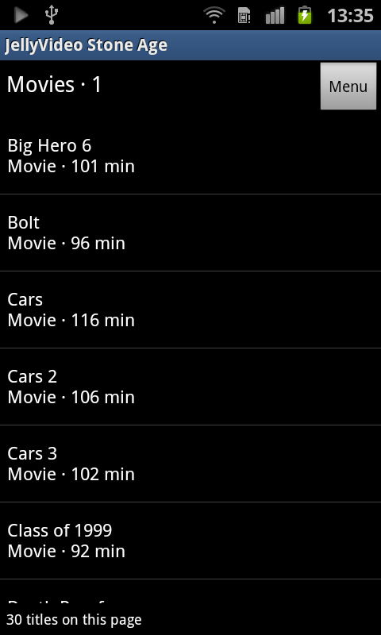

# JellyStone Video

A lightweight Jellyfin movie and TV client for **Android 1.5+ (API 3)**. Formerly JellyVideo Stone Age. The package ID remains `org.jellylegacy.videostone` for updates that preserve the login.

[Download 0.4.0](https://github.com/DerAustistYT/jellystone-video/releases/latest) · [All four apps](https://github.com/DerAustistYT/jellyfin-legacy-clients)

## Features

- Quick Connect, saved login/server and logout.
- Movies, TV shows, seasons, episodes, search, favorites and watched/unwatched state.
- Continue watching/resume, play from the beginning, paginated native text lists, refresh and hardware Menu/Back navigation.
- Built-in native video player with pause/resume, seeking and elapsed/total time. Controls hide during playback and return on tapping the screen.
- Compatible small fast-start MP4 originals stream through an authenticated loopback range proxy.
- Other movies buffer roughly 20 seconds first, then prefetch roughly 45-second clips. Fragmented MP4 is remuxed to classic MP4 on disk for old players; consumed clips are deleted.
- Whole-file compatibility fallback when progressive/chunk playback is unsuitable.
- Java-only TLS 1.2 independent of the phone's old HTTPS implementation; no CPU-specific native libraries.

## Playback and limits

Server transcoding requests H.264 baseline, up to 320×240, 15 fps and 250 kb/s, with mono AAC at 48 kb/s. Uses the device's MediaPlayer/decoder; Jellyfin must permit transcoding. Buffer files are capped at 32 MB; full-download fallback is capped at 256 MB and may temporarily require roughly twice that space. Server load, network speed and old device codecs affect startup and transitions.

**Login, browsing and movie playback confirmed on Samsung Galaxy S2 GT-I9100, Android 2.3.3.** App source compiles against actual API 3 and APK signatures support Android 1.5. Android 1.5 hardware, all seek/resume cases and every clip transition remain unverified. TLS 1.3-only servers are unsupported. Desktop checks verified MP4 remuxing and progressive authenticated byte ranges.

## Screenshot



The S2's hardware video overlay does not appear in ADB framebuffer screenshots, so the library is shown here.

## Build

Requires Windows PowerShell, Python 3, JDK 17, Android SDK platform 35 and build-tools 35.0.0, plus an Android 1.5/API 3 `android.jar`. Set `JAVA_HOME` and `ANDROID_HOME`, then run:

```powershell
./build.ps1 -Api3Jar 'path/to/android-3/android.jar'
```

The build fetches Bouncy Castle 1.86 from Maven Central with pinned SHA-256 checks, relocates its packages to avoid Android's built-in older crypto library, compiles against API 3, and shrinks/signs a development APK in `.build`. It generates a local debug key, so development builds cannot update the signed GitHub release in place. Release signing keys are not included. The bundled dependency license and CA-bundle attribution are included.

## Privacy and credits

Server addresses and session credentials remain on the device. The source contains no private server address, signing key or local user paths. HTTP is supported but unencrypted. HTTPS uses TLS 1.2, bundled Mozilla CA roots, certificate-chain checks and hostname checks; keep the phone clock correct. Private/self-signed certificates are not automatically trusted.

OpenAI Codex implemented these clients using the JellyMusic Legacy project, whose development also involved Anthropic Claude. See [AI contributors](CONTRIBUTORS.md).
